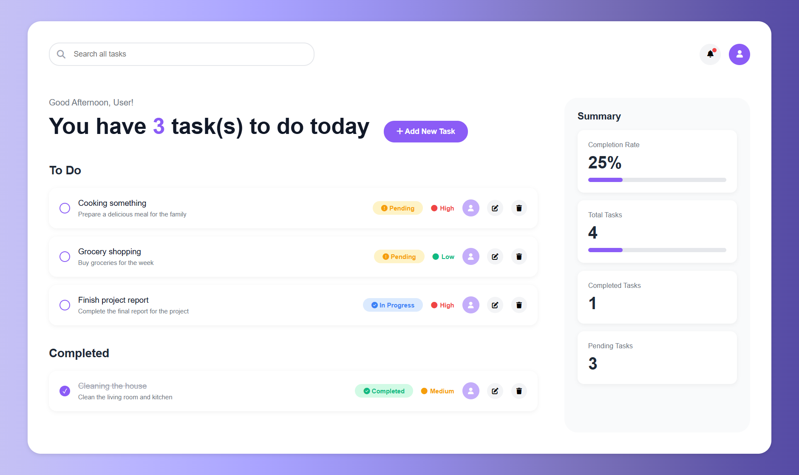

# TO-DO TODAY ✅

A clean, responsive task management web app built with **vanilla HTML, CSS and JavaScript**. Add, edit, complete and delete tasks, track your progress at a glance, and pick up right where you left off thanks to browser persistence.

> **Screenshot:**

---

## Table of Contents

- [Overview](#overview)
- [Features](#features)
- [Tech Stack](#tech-stack)
- [Getting Started](#getting-started)
- [Project Structure](#project-structure)
- [How It Works](#how-it-works)
- [What I Learned](#what-i-learned)
- [Roadmap](#roadmap)
- [Author](#author)

---

## Overview

TO-DO TODAY is a front-end productivity app designed around a simple question: *"What do I need to get done today?"* The dashboard greets the user based on the time of day, shows how many tasks are outstanding, and separates work into **To Do** and **Completed** lists, while a summary sidebar visualises overall progress.

The project was built without any frameworks or build tools to demonstrate a solid grasp of core web fundamentals: DOM manipulation, state management, event handling, data persistence and modern CSS layout.

## Features

- **Full CRUD** – create, read, update and delete tasks through modal forms
- **Task details** – each task has a title, description, status (Pending / In Progress / Completed) and priority (Low / Medium / High)
- **One-click completion** – tick a task to move it between *To Do* and *Completed*, with strikethrough styling on finished items
- **Persistent data** – tasks are saved to `localStorage`, so they survive page refreshes and browser restarts
- **Live progress dashboard** – the sidebar shows completion rate, total, completed and pending counts, with animated progress bars
- **Dynamic greeting** – "Good Morning / Afternoon / Evening" based on the user's local time
- **Colour-coded badges** – status and priority are visually distinct at a glance
- **Delete confirmation** – prevents accidental removal of tasks
- **Empty states** – friendly messages when a list has no tasks
- **Responsive layout** – CSS Grid layout that collapses to a single column on smaller screens
- **Polished UI** – gradient background, rounded cards, hover animations and smooth transitions

## Tech Stack

| Area | Technology |
| --- | --- |
| Markup | HTML5 (semantic sections, accessible form labels) |
| Styling | CSS3 (Grid, Flexbox, custom gradients using `oklch`, transitions, media queries) |
| Logic | Vanilla JavaScript (ES6+) |
| Storage | Browser `localStorage` API |
| Icons | [Font Awesome](https://fontawesome.com/) |

No dependencies, no build step, no package installs.

## Getting Started

### Prerequisites

A modern web browser (Chrome, Firefox, Edge or Safari). An internet connection is needed to load the Font Awesome icons.

### Run locally

1. **Clone the repository**
   ```bash
   git clone https://github.com/Tifuh-n/your-repo-name.git
   ```
2. **Open the project folder**
   ```bash
   cd your-repo-name
   ```
3. **Launch the app** – open `index.html` in your browser, or serve it with a simple local server:
   ```bash
   # Python
   python -m http.server 8000

   # or, with the VS Code "Live Server" extension, right-click index.html → "Open with Live Server"
   ```
4. Visit `http://localhost:8000` if you used a local server.

## Project Structure

```
.
├── index.html   # Page structure, dashboard layout and add/edit modals
├── style.css    # All styling: layout, components, modals, responsive rules
├── script.js    # App logic: state, rendering, CRUD, persistence, statistics
└── README.md
```

## How It Works

- **State** – tasks live in a single `tasks` array of objects (`id`, `title`, `description`, `status`, `priority`, `completed`). The `completed` flag is always kept in sync with `status`, whether a task is added, edited or ticked off.
- **Rendering** – `renderTasks()` filters the array into *To Do* and *Completed* lists, rebuilds the DOM from template strings, recalculates all statistics and saves to `localStorage`. Every user action funnels through this one function, keeping the UI consistent with the data.
- **Persistence** – on load, `loadTasks()` reads from `localStorage`; if nothing is stored, it seeds the list with a few example tasks.
- **Modals** – separate Add and Edit modals are toggled with an `.active` CSS class; the edit flow tracks the task being edited by its unique ID.
- **Safe rendering** – user-entered text is HTML-escaped before it is inserted into the page, preventing HTML injection.
- **Unique IDs** – new tasks are given `Date.now()` as their ID to avoid collisions after deletions.
- **Statistics** – completion percentage is calculated from the completed vs total counts and drives both the text values and the progress bar widths.

## What I Learned

- Structuring a small application around a single source of truth and a central render function
- Manipulating the DOM dynamically and handling form submission events
- Persisting and restoring application state with `localStorage` and JSON
- Building responsive layouts with CSS Grid and Flexbox
- Designing consistent UI components (cards, badges, modals, progress bars)
- Debugging state and UI-sync issues across multiple user flows

## Roadmap

Planned improvements and ideas for future versions:

- [ ] Make the search bar functional (filter tasks by title/description)
- [ ] Add due dates and sort/filter by priority or status
- [ ] Drag-and-drop reordering
- [ ] Dark mode
- [ ] Editable user name and profile
- [ ] Notifications/reminders
- [ ] Keyboard accessibility and ARIA improvements
- [ ] Unit tests for core logic

## Author

**Tifuh Nche**
<!-- - Portfolio: [your-site.com](https://your-site.com) -->
- LinkedIn: [linkedin.com/in/tifuh](https://linkedin.com/in/tifuh)
- GitHub: [@Tifuh-n](https://github.com/Tifuh-n)

---

_If you found this project useful or interesting, feel free to give it a ⭐_
